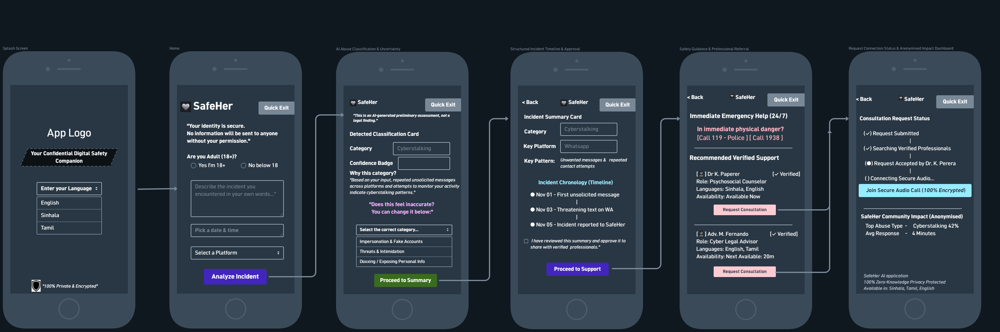

# SafeHer AI — Working Prototype (Build 1)

SafeHer AI is an open-source, multilingual digital safety and protection platform designed to help women and girls identify, document, and respond to technology-facilitated abuse through privacy-preserving artificial intelligence and verified human support.

## Official Documentation & Architecture
- 📄 [Technical Architecture & Safeguarding Specification (PDF)](docs/SafeHer_AI_Architecture_and_Safeguarding.pdf)
- ⚖️ [MIT Open-Source License](LICENSE)

## Architecture & Technology Stack
- **Frontend**: Next.js v15 (App Router), TypeScript, Tailwind CSS v4, Lucide Icons
- **Backend**: Python 3.13, FastAPI, SQLAlchemy, Uvicorn
- **Database**: PostgreSQL (Supabase-hosted cloud instance)
- **Languages Supported**: Sinhala, Tamil, English (Trauma-informed localization)

## UI/UX Design & Architecture


## End-to-End Workflow Demonstrated
1. **Multilingual Intake**: Language selection and structured reporting for adult & under-18 pathways.
2. **AI Classification Engine**: Rule-based preliminary assessment explaining confidence score & rationale.
3. **Human-in-the-Loop Agency**: User ability to correct AI classifications and approve chronology.
4. **Emergency & Professional Referral**: Verified directory of psychosocial counselors & legal advisors.
5. **Real-Time Request Lifecycle**: Request dispatch, specialist acceptance, and anonymised community analytics.

## Local Setup & Installation

### 1. Backend Setup
```bash
cd safeher-backend
python -m venv .venv
# Activate virtual environment
# Windows: .venv\Scripts\activate
pip install fastapi uvicorn sqlalchemy psycopg2-binary pydantic
uvicorn main:app --reload --port 8001